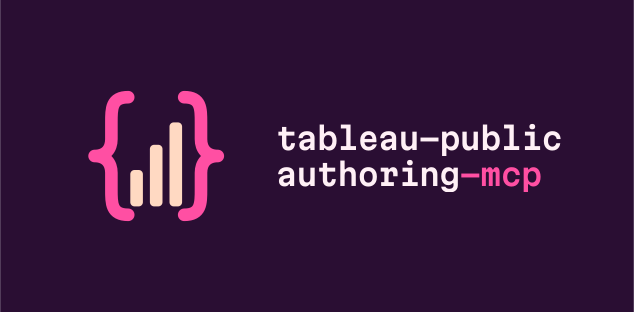
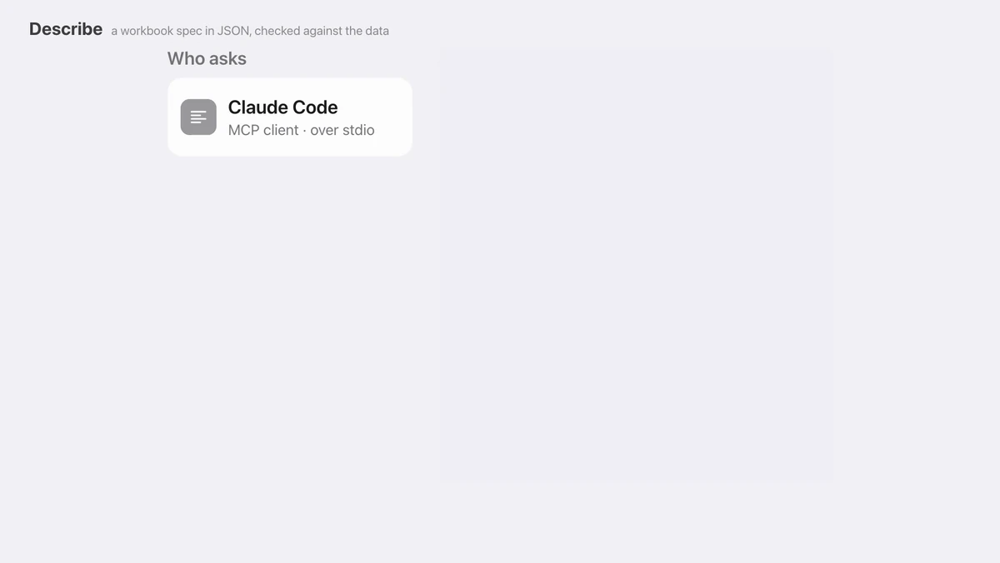
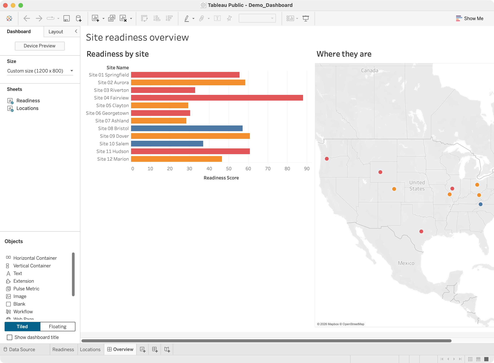
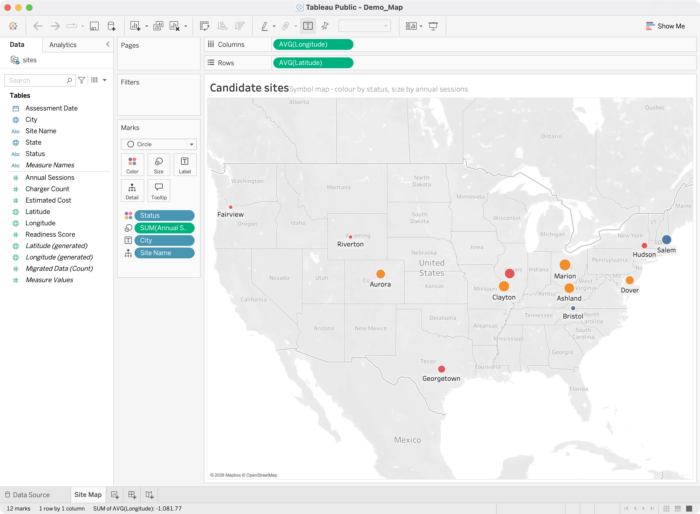
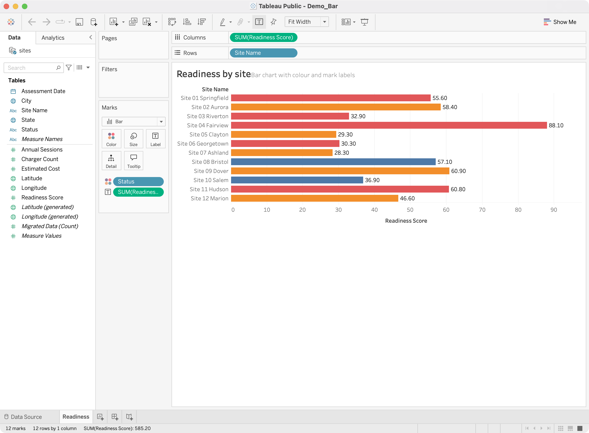

<p align="center">
  
</p>

# Tableau Public Authoring MCP

<p align="center">
  <a href="https://andyyaro.github.io/tableau-public-authoring-mcp/film.html"></a>
</p>

<p align="center"><b>Watch the 68-second launch film:</b> <a href="https://andyyaro.github.io/tableau-public-authoring-mcp/film.html">with sound and captions</a> · <a href="https://andyyaro.github.io/tableau-public-authoring-mcp/film/tableau-mcp-launch.mp4">MP4, 13.8 MB</a> · <a href="media/launch-film/">how it was made</a></p>

An MCP server that **authors** Tableau workbooks from a declarative spec, **validates**
them by opening them in the installed Tableau Public application, and **publishes**
through Tableau's own visible desktop workflow.

> This is the counterpart to the existing **reader** MCP (`tableau-public`), which
> inspects already-published content. The reader cannot create or publish anything.
> This server cannot browse public profiles. Keep both installed.

---

## What it produces

Every screenshot below is a workbook generated from a JSON spec by this server,
then opened in Tableau Public 2026.2.0 and photographed. Nothing was authored by
hand, and nothing was touched in Tableau before the screenshot was taken. The
data is the synthetic 12-row fixture in `tests/fixtures/data/`.

**A dashboard** - two generated worksheets tiled in one container, fixed 1200×800
canvas, title rendered:



**A symbol map** - `latitude`/`longitude` detected from the column names and
tagged with Tableau's `[Geographical]` semantic role, which is what puts a real
background map behind the marks. One mark per site, coloured by a dimension and
sized by a measure:



**A bar chart** - colour by dimension, mark labels drawn, canvas fit applied:



The spec behind the map is the whole input:

```json
{
  "name": "Site Map",
  "template": "map",
  "data_source": "sites",
  "detail": ["Site Name"],
  "color": "Status",
  "size": { "field": "Annual Sessions", "aggregation": "Sum" },
  "title": "Candidate sites"
}
```

---

## What it does

| | Reader MCP (`tableau-public`) | This server (`tableau-public-authoring`) |
|---|---|---|
| Search / inspect public profiles | ✅ | ❌ |
| Download & unpack `.twbx` | ✅ | inspect only |
| **Create** a workbook | ❌ | ✅ |
| **Open** it in Tableau Public | ❌ | ✅ |
| **Publish** to your account | ❌ | ✅ (visible UI) |

## Verified capabilities

Everything below was confirmed by generating a workbook and **opening it in
Tableau Public 2026.2.0 on macOS**, not merely by producing XML.

**Supported**
- CSV data sources, automatically materialised into `.hyper` extracts
- Field type inference: string, integer, real, boolean, date, datetime
- Worksheet templates: `bar`, `line`, `text_table`, `heatmap`, `scatter`, `circle`, `map` (all seven screenshot-verified in Tableau Public 2026.2.0, and re-checked on every live run by `tests/live/test_render_templates.py`)
- Geographic roles: latitude/longitude columns detected by name, which is what puts a real background map behind the `map` template
- Dashboards: title, fixed or automatic canvas, worksheets tiled in one container
- Calculated fields (Tableau formula syntax)
- Categorical filters, rendered as interactive filter cards
- Encodings: color, size, label, tooltip, and **detail** - `detail` raises the level of detail, so a scatter draws one mark per site instead of one per colour value
- Canvas fit: `standard`, `fit_width`, `fit_height`, `entire_view`
- Worksheet titles and subtitles
- `.twbx` packaging, with a byte-deterministic `.twb` inside

**Not supported in v0.1** - see `docs/architecture/CAPABILITY_BOUNDARY.md`
- Stories, parameters, LOD expressions, joins/custom SQL, live connections
- Sets, groups, hierarchies, table calculations, reference lines
- Filled/choropleth maps, custom territories, map layers, spatial files
- Dashboard filter cards, legends, actions, floating zones, device layouts

**Two claims to read carefully**

- **The `.twbx` is not byte-reproducible.** The `.twb` inside it is - identical
  spec, identical bytes. The archive is not, because the embedded `.hyper` is
  written by Tableau's Hyper engine and carries non-deterministic internal state.
  Diff the `.twb`, never the package digest. See `docs/LIMITATIONS.md` §1.
- **A standalone `.twb` is only usable next to its data directory.**
  `output.package_twbx: false` writes `<name>.twb` **plus** a `<name>.data/`
  directory holding each source's `.hyper` and CSV, and the `.twb` resolves its
  data relative to itself - so keep the two together, or move them together. A
  packaged build produces the same layout under `Data/`, matching what is inside
  the archive. Paths are always relative by necessity, not by preference: an
  absolute path would embed a home directory, and `build_workbook` refuses to
  emit machine-identifying data (see `docs/architecture/THREAT_MODEL.md`, T6).

## Two constraints that shape everything

1. **Tableau Public has no publishing API.** The REST API covers Server/Cloud only,
   so publishing is driven through the real UI. Tableau documents the command as
   `Server > Tableau Public > Save to Tableau Public`, but that is the Desktop
   Professional path: in the **Public** edition (2026.2.0) the Server menu holds
   only `Run Optimizer...` and the command lives on the **File** menu. It is
   invoked with a real Command+Shift+S key event, with the File menu as a
   fallback - see `docs/PUBLISHING_WORKFLOW.md`.
2. **Tableau Public rejects non-extract data sources** (`Error Code: 3C242D89`).
   Every CSV is therefore converted to a Hyper extract at build time.

## Install

```bash
uv tool install git+https://github.com/andyyaro/tableau-public-authoring-mcp
tableau-public-authoring doctor
```

No clone, no virtualenv, no paths to edit. `doctor` checks everything the server
needs and prints exactly what to fix - run it **before** registering, because
every prerequisite below fails *silently* at runtime rather than raising:

```
  [PASS] platform          macOS
  [PASS] python            3.13.14 at ~/.local/share/uv/tools/…/bin/python
  [PASS] mcp sdk           importable
  [PASS] tableauhyperapi   importable
  [PASS] quartz (pyobjc)   importable
  [PASS] tableau public    2026.2.0 at /Applications/Tableau Public.app
  [PASS] accessibility     granted to this process
  [PASS] screen recording  capture succeeded
```

| Missing | What you would actually see |
|---|---|
| Quartz | Tableau appears to have no windows open; publishing says "no document window matching …" |
| Screen Recording | validation screenshots come back blank, with no error |
| Accessibility | keystrokes and clicks go nowhere |
| tableauhyperapi | no workbook can be built at all |

macOS permissions are granted **per executable**, so grant them to the
interpreter `doctor` prints - not to Tableau, and not to your terminal if you
register a different one. Details in `docs/MACOS_PERMISSIONS.md`.

Requirements: macOS with Tableau Public installed (developed against 2026.2.0,
Apple silicon), Python ≥ 3.10, and [`uv`](https://docs.astral.sh/uv/).

### Register with Claude Code

```bash
claude mcp add --transport stdio --scope user tableau-public-authoring \
  -- tableau-public-authoring
```

That is the whole command - `uv tool install` puts the executable on your PATH
at a stable location, so there is no absolute path to substitute and it survives
upgrades. Registering does **not** affect any other MCP server; verify with
`claude mcp list`. Restart Claude Code before the tools appear.

<details>
<summary>Installing from a clone instead (for development)</summary>

```bash
git clone https://github.com/andyyaro/tableau-public-authoring-mcp
cd tableau-public-authoring-mcp
uv venv && uv sync && uv pip install -e .
uv run tableau-public-authoring doctor
```

Register that build by pointing at its interpreter explicitly:

```bash
claude mcp add --transport stdio --scope user tableau-public-authoring \
  -- /absolute/path/to/.venv/bin/python -m tableau_public_authoring.server
```

Avoid `uvx --from …` for the registered server: it runs from a
content-hashed cache path that **changes whenever a dependency changes**, and the
macOS permission grants are tied to that path - so the server would quietly lose
Accessibility and Screen Recording on the next upgrade. It is fine for one-off
use such as `uvx --from … tableau-public-authoring doctor`.

</details>

## Upgrading

```bash
uv tool upgrade tableau-public-authoring
tableau-public-authoring doctor
```

## Build a workbook

```json
{
  "spec_version": "0.1",
  "workbook": { "name": "EV Charging Readiness", "description": "Generated" },
  "data_sources": [{ "id": "sites", "type": "csv", "path": "/abs/path/sites.csv" }],
  "calculated_fields": [{
    "name": "Readiness Band", "data_source": "sites", "datatype": "string",
    "formula": "IF [Readiness Score] >= 70 THEN \"High\" ELSE \"Low\" END"
  }],
  "worksheets": [{
    "name": "Readiness by Site", "template": "bar", "data_source": "sites",
    "rows": ["Site Name"],
    "columns": [{ "field": "Readiness Score", "aggregation": "Sum" }],
    "color": "Readiness Band",
    "filters": ["Status"],
    "title": "EV Charging Readiness by Site"
  }],
  "output": { "directory": "/abs/path/output", "package_twbx": true }
}
```

Paths may be relative to a single `base_dir` instead of absolute - and a relative
path is *confined* to that directory, which an absolute path is not. See
`docs/AUTHORING_SPEC.md`.

Then: `validate_workbook_spec` (dry run) → `build_workbook` →
`validate_in_tableau_public` → `publish_to_tableau_public`.

Full schema: `schemas/workbook-spec-v0.1.json` and `docs/AUTHORING_SPEC.md`.

## Why things are the way they are

Most of this codebase's shape is a response to something Tableau actually did.
`docs/LIMITATIONS.md` lists the constraints; `docs/history/CHANGE_HISTORY.md`
keeps the release write-ups, which record the failure each fix was responding to
and what proved it fixed. `docs/fixtures/` holds the forensic analysis of a real
published workbook that the compiler was reverse-engineered from.

## Publishing

`publish_to_tableau_public` is marked destructive and requires both
`confirm_publish: true` and `profile` (your Tableau Public profile name);
`overwrite` defaults to `false`. `profile` is required because without it the
server cannot check whether a workbook of that name is already live, and Tableau
Public replaces a same-named workbook irreversibly, with no version history.

It drives the visible command and **never reads, types, or stores credentials** -
it uses your existing signed-in desktop session. If Tableau needs a sign-in, the
tool stops and tells you to sign in manually. Publication is irreversible and
world-visible.

Use `dry_run: true` to see exactly what would happen first.

## Tests

```bash
uv run pytest                    # unit + integration (no Tableau needed)
uv run pytest -m live            # requires Tableau Public installed
uv run ruff check . && uv run ruff format --check .
```

`live` and `publish` tests are excluded from normal runs and must never run in CI.

## Security

No credentials are stored anywhere. XML is generated through `ElementTree`
(never string concatenation), archives are ZIP-slip guarded, paths are
traversal-checked, and generated workbooks are scanned for machine-identifying
data before packaging. See `docs/SECURITY.md` and
`docs/architecture/THREAT_MODEL.md`.

## Rollback

```bash
claude mcp remove --scope user tableau-public-authoring
```

This leaves all other MCP servers untouched.

## Uninstalling

```bash
claude mcp remove tableau-public-authoring -s user
claude mcp list          # your other servers should still be listed
rm -rf <this repo>/output   # generated workbooks are inert local files
```

Anything already **published** must be deleted by you from your Tableau Public
profile in the browser. This server has no delete capability, by design:
publication is irreversible from its side, which is why it requires
`confirm_publish` and refuses a name collision unless you pass `overwrite`.

## License

MIT - see `LICENSE`.
